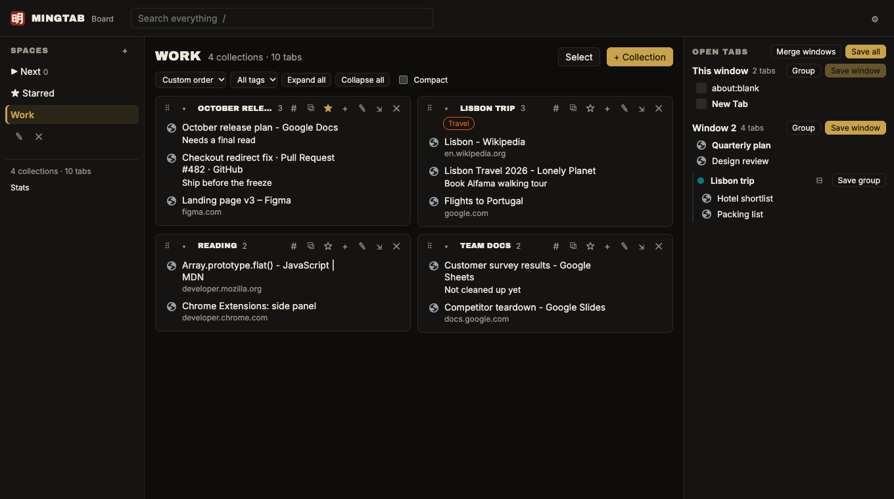
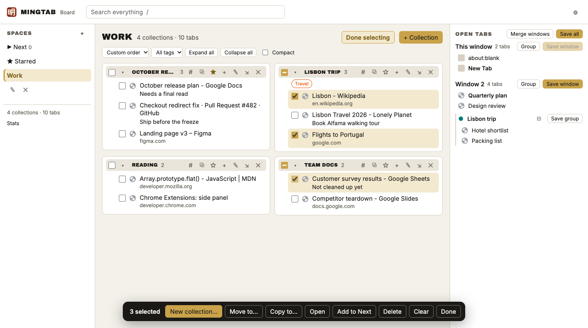
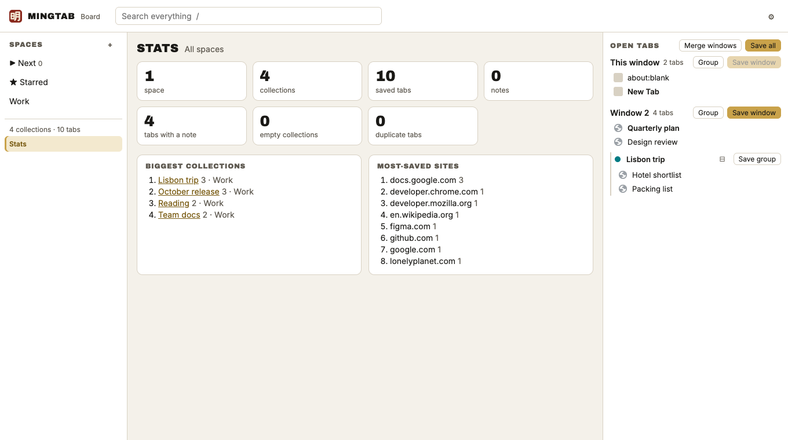
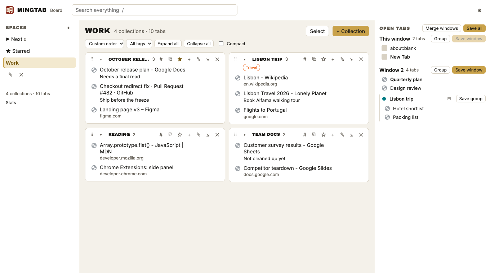
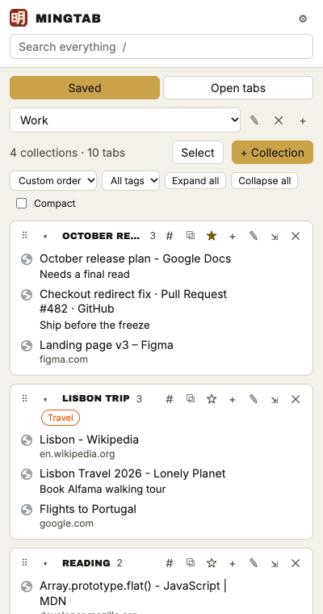
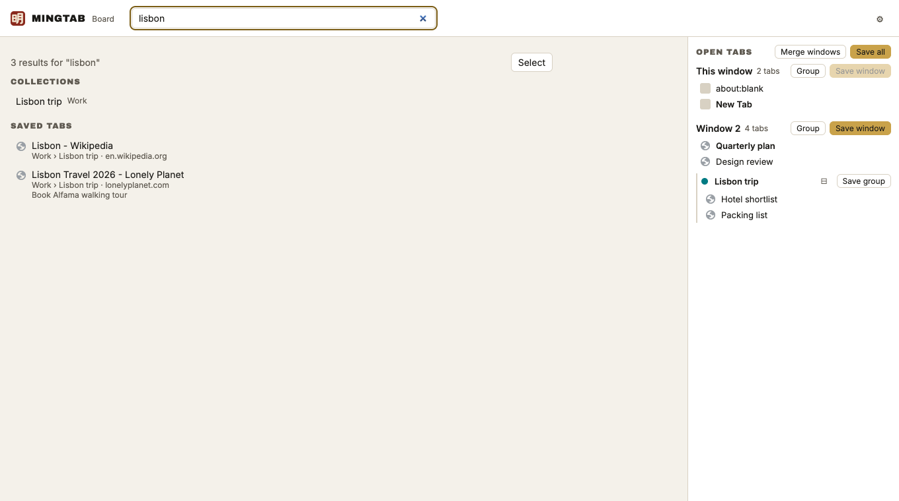

<p align="center">
  
</p>

<h1 align="center">MingTab</h1>

<p align="center">
  <b>Keep your tab bar clear.</b><br>
  Save your open tabs as collections, sort them into spaces, and bring them back when you need them.
</p>

<p align="center">
  <a href="https://github.com/kratner/mingtab/releases/latest"></a>
  
  <a href="https://fourounces.live/"></a>
</p>

<p align="center">
  <a href="#install"><b>Install</b></a> ·
  <a href="#using-mingtab">How to use it</a> ·
  <a href="#your-data">Your data</a> ·
  <a href="CHANGELOG.md">What's new</a> ·
  <a href="#development">Development</a>
</p>



MingTab is a tab manager for Chrome and other Chromium browsers. Your collections live on your
own computer. Sync between computers is optional.

## What it does

**Save and restore**

- **Save tabs without losing them.** Save a window, a tab group or a single tab as a collection.
  Saving closes the tabs by default; you can keep them open instead.
- **Save everything at once.** **Save all** keeps every window in one collection, and **Open all**
  puts each window back where it was, tab groups included.
- **Bring them back.** Open one card or a whole collection. A collection saved from a tab group
  reopens as a tab group with the same name and color.

**Organise**

- **Spaces, collections and cards.** Drag to reorder, move cards between collections, or drop a
  collection onto another space. Tag, star, sort and merge collections.
- **Select mode.** Tick cards anywhere (across collections, spaces and search results), then
  make a new collection from them, move or copy them, open them, or delete them. Every action can
  be undone.
- **Stats.** How many collections and saved tabs you have, the biggest collections, your
  most-saved sites, empty collections and duplicates.
- **Tidy up.** Find pages saved more than once and remove the extra copies.

**Find and use**

- **One search for everything:** what you've saved, your open tabs and (if you turn it on) your
  browsing history. Press **/** from anywhere.
- **Next, notes and shortcuts.** A to-read queue, notes with checklists, and address-bar
  shortcuts: type `to/ docs` to open the card you named `docs`.
- **Manage open tabs.** See every window and tab group, rename and recolor groups, and merge all
  windows into one.

**And**

- **Sync** across Chrome profiles and computers, through a small sync service on your own
  Cloudflare account, signed in with Google.
- **Tells you when a new version is out**: it checks for releases once a day.
- **Light and dark themes**, in the Four Ounces gold scheme or a terracotta one.

| Select mode | Stats |
|---|---|
|  |  |

| Board in light mode | Side panel | Search |
|---|---|---|
|  |  |  |

### Why "MingTab"?


明堂 *míngtáng*, "the bright hall", is the open, uncluttered space in front of a building in
feng shui: the place where qi, the energy of a place, gathers before it flows inside. Clutter
there blocks it; a clear approach lets it in. 明 *míng*, "bright", joins 日 (sun) and 月 (moon).
Forty open tabs are a cluttered approach; MingTab keeps yours clear. The same note is in the
extension under **Settings → About MingTab**.

---

## Install

MingTab isn't in the Chrome Web Store. Each release is a zip on this repository's
[Releases page](https://github.com/kratner/mingtab/releases); you load it into Chrome yourself.
About two minutes. What changed in each release: [CHANGELOG.md](CHANGELOG.md).

### 1. Download and unzip

Download the latest **`mingtab-<version>.zip`** from
[Releases](https://github.com/kratner/mingtab/releases). Unzip it into a folder you'll keep, for example
`~/Applications/MingTab` on a Mac or `C:\Users\<you>\MingTab` on Windows.

> **Windows:** "Extract All" suggests a new folder named after the zip. That's fine the first
> time. When you update, extract into the folder Chrome already loads, not a new one beside it.

Every copy of MingTab has the same extension ID (`jclkedgbnlmbonoihhobgnmdoehmddpo`, fixed by the
manifest's `key`), so the folder name and location don't matter.

### 2. Load it into Chrome

1. Open `chrome://extensions`.
2. Turn on **Developer mode** (top right).
3. Click **Load unpacked** and choose the folder you unzipped into (the one containing
   `manifest.json`).
4. Click the puzzle-piece icon in the toolbar and **pin MingTab**.

Now:

- **Click the MingTab icon** (明) to open the side panel.
- **Open a new tab** to see the full board.

> **If another extension also replaces the new-tab page or uses the `to/` keyword**,
> Chrome can only give each to one extension. Turn the other extension off in
> `chrome://extensions`, then restart Chrome (⌘Q) if it still wins.

Other browsers: Edge, Brave and Vivaldi load the same zip from their own extensions page
(`edge://extensions`, `brave://extensions`, `vivaldi://extensions`). See [BROWSERS.md](BROWSERS.md)
for what's tested and what isn't.

> **Vivaldi:** a new tab opens Vivaldi's Start Page, not MingTab, and MingTab isn't offered under
> **Settings → Tabs → New Tab Page → Controlled by Extension**. Instead, in **Settings → General**,
> set **Homepage** to
> `chrome-extension://jclkedgbnlmbonoihhobgnmdoehmddpo/src/newtab/index.html`
> New tabs (⌘T) then open the MingTab board. If they don't, set **Settings → Tabs → New Tab Page**
> to **Homepage**.
>
> Vivaldi also doesn't let extensions add address-bar keywords, so `to/` shortcuts need a search
> engine instead: **Settings → Search → +**, name it MingTab, nickname `to`, URL
> `chrome-extension://jclkedgbnlmbonoihhobgnmdoehmddpo/src/newtab/index.html#go=%s`
> (MingTab's Settings has a Copy button for it). Then type `to docs` in the address bar.

### 3. Sign in to sync

**Settings (⚙) → Sign in with Google**, and choose your Google account. Everything you have in
MingTab elsewhere arrives within a minute. Do this in each Chrome profile and on each computer.

Sync is optional: everything else works without signing in. The released zips sync to the
author's own service, which accepts only the author's Google account. To sync your copy, deploy
the Worker in `worker/` to your Cloudflare account and point `sync.config.json` at it (see
[SYNC.md](SYNC.md)).

### Updating

MingTab checks this repository's Releases about once a day. When a newer version is out, the toolbar
button shows **↑** and the board and side panel show a notice:

1. Click **Download** and unzip the zip **over the same folder** (replace everything). Not sure
   which folder? `chrome://extensions` shows it on MingTab's card, under **Developer mode**.
2. Within a minute MingTab notices the new files and the notice changes to **Restart MingTab**. Click
   it. Open MingTab pages close and the new version starts. Your data stays.

**Skip this version** quiets the notice until the next release. **Settings → Updates** has **Check now**
and a switch for the daily check. If MingTab doesn't come back after the restart, click its reload icon
(↻) in `chrome://extensions`.

Chrome only updates extensions on its own when they come from the Chrome Web Store, so the unzip step
stays manual.

### Uninstalling

**Download a backup first** (Settings → Backup): removing the extension deletes its data.
Then click **Remove** on MingTab in `chrome://extensions`.

---

## Using MingTab

| To | Do this |
|---|---|
| Save a whole window | Open tabs pane → **Save window** |
| Save every window at once | Open tabs pane → **Save all**. One collection named "All windows <date, time>"; **Open all** on it reopens each window where it was on screen, with its tab groups |
| Save a tab group | Open tabs pane → **Save group** on the group |
| Save one tab | Hover it in the open tabs pane → **⤓** → pick a collection, or drag it by its **⠿** grip onto one (board only) |
| Reopen a collection | **⧉** in its header (a saved tab group comes back as a group) |
| Search | Type in the search box, or press **/** from anywhere. **Esc** clears. |
| Reorder | Drag a collection by **⠿**, or drag a card by the **⠿** grip that appears when you hover it (to another collection, too). Keyboard: focus it, **Space**, arrow keys, **Space**. |
| Move a collection to another space | Drag its **⠿** onto the space in the sidebar |
| Pick cards from anywhere | **Select** in a space's header (or above search results), tick cards, then use the bar along the bottom. Shift-click ticks a range; a collection's header box ticks all of it. **Esc** or **Done** to finish. |
| Make a collection from picked cards | Select mode → **New collection…** (move or copy them in) |
| See totals | The tab count is beside each space's name; **Stats** under the spaces list has the rest |
| Tag a collection | **#** in its header |
| Merge two collections | **⇲** in the header of the one to merge away |
| See starred collections | **★ Starred** at the top of the spaces list |
| Line up what to read next | **▶** on a card or an open tab; then **▶ Next** at the top of the spaces list. Tick items off, drag to reorder. |
| Write a note | **✎** in a collection's header. `- [ ] task` makes a checklist; `**bold**`, `*italic*` and links work. |
| Change a saved tab's address | ✎ → **Address**. A bare domain (`imdb.com`) gets `https://`. |
| Jump to a page from the address bar | Give a card a shortcut (✎ → Shortcut), then type **to/**, press Space, and type the shortcut: `to/ docs`. All shortcuts are listed in Settings. If another extension also uses `to/`, turn it off. In Vivaldi, add the search engine described under Vivaldi above and type `to docs`. |
| Use a popup instead of the side panel | Settings → **Toolbar button** |
| Sync another profile or computer | Settings → **Sign in with Google** |
| Remove duplicates | Settings → **Find duplicates** (nothing is removed until you confirm) |
| Keep tabs open when saving | Settings → untick **Close tabs after saving** |

Pinned tabs are never saved with a window or closed.

---

## Your data

Everything is stored **locally, inside the extension, in the Chrome profile you loaded it into**
(IndexedDB, plus a few display preferences in local storage). Your collections leave the machine
only if you sign in to sync. Otherwise the only network requests are the daily update check and
site icons: Chrome's own icon cache comes first, and if it doesn't have one, the icon saved with
the card loads from that site.

| Your data survives | Your data does **not** survive |
|---|---|
| Restarting Chrome or the computer | Removing the extension |
| Reloading the extension, updating from a new zip, rebuilding | Removing the extension, then loading it again (unless you're signed in to sync, which brings everything back) |
| Turning the extension off and on | Clearing data for the extension |

**Back up**: Settings → **Download backup** saves everything as one JSON file. **Restore from
backup** replaces what's in MingTab with the file's contents.

### Sync across machines

Settings → **Sign in with Google** in each Chrome profile, on each computer. Everything syncs
through the MingTab sync service (`worker/`, a Cloudflare Worker with a D1 database on Keith's
Cloudflare account), which accepts only the allowed Google account. Syncing runs every minute,
at startup, and a couple of seconds after any change. Signing out keeps your data on that device.

The phone version (a web app, since Chrome on phones doesn't run extensions) is next; see
[SYNC.md](SYNC.md).

### Permissions

| Permission | Why |
|---|---|
| `tabs`, `tabGroups` | List open tabs and groups, save them, reopen them, group/ungroup |
| `sidePanel` | Open MingTab in Chrome's side panel |
| `storage`, `unlimitedStorage` | Keep your collections locally, without Chrome's size cap |
| `favicon` | Show site icons from Chrome's own cache (no third-party icon service) |
| `history` (optional) | Only if you turn on history search; Chrome asks first |
| `identity` | Google sign-in for sync |
| `alarms` | Sync every minute, and check for updates about once a day |
| Access to `mingtab-sync.mingtab-sync.workers.dev` | The sync service, and no other site |
| Reading `api.github.com` (needs no permission) | The daily update check reads this repository's latest release; nothing is sent |
| Address-bar keyword `to/` | `to/ docs` opens your shortcut (only one extension can have a keyword) |
| New-tab page override | Show the board on new tabs |

MingTab never reads the content of the pages you visit, only the title, address and icon of tabs
you choose to save.

---

## Development

### Build from source

Needs Node.js 22.12 or newer and access to this repository:

```sh
git clone git@github.com:kratner/mingtab.git   # or https://github.com/kratner/mingtab.git
cd mingtab
npm ci
npm run build      # writes dist/; Load unpacked that folder
```

After `git pull && npm run build`, a MingTab loaded from `dist/` offers **Restart MingTab** within a
minute, the same as after unzipping a release.

### Making a release

Add a `## <version> — <date>` section to `CHANGELOG.md`, bump `version` in `package.json`, commit,
then tag and push:

```sh
git tag v1.2.3 && git push origin v1.2.3   # the version in package.json
```

The **Release** workflow (`.github/workflows/release.yml`) checks the tag matches
`package.json`, typechecks, runs the unit tests, builds, and publishes `mingtab-<version>.zip` on a
GitHub Release whose notes are that version's CHANGELOG section plus install steps (packaging fails if
the section is missing). `npm run package` makes the same zip locally in `release/`.

### Everyday commands

```sh
npm run dev        # live-reloading build in dist/ (needs the dev server running)
npm run build      # production build in dist/
npm run check      # typecheck + unit tests + browser tests
```

`npm run dev` makes a build that loads code from a local dev server. Run `npm run build` again
before using MingTab day to day, or it stops working when the dev server isn't running.

| Command | What it runs |
|---|---|
| `npm run typecheck` | TypeScript, no output |
| `npm test` | Unit tests (Vitest): data layer, import, search, duplicates, drag-and-drop logic |
| `npm run e2e` | Builds `dist-test/` (never `dist/`, which your Chrome loads) against a local copy of the sync service, then Playwright drives it in Chromium: saving windows and tab groups, drag and drop, import, search, notes, Next, shortcuts, layout at phone-to-desktop widths, and two profiles syncing |
| `npm run check` | All of the above, plus the sync service's tests |

The first browser-test run needs `npx playwright install chromium`. Tests that use a real data
export run only when one is present in `imports/`, a folder git ignores.

**Stack:** TypeScript, React, Vite with [CRXJS](https://crxjs.dev/) (Manifest V3), Dexie
(IndexedDB), dnd-kit (drag and drop), Vitest, Playwright.

```
src/
  app/        UI: board, side panel, collections, cards, settings
  db/         records, database, ordering (fractional positions), create/edit/delete
  dnd/        drag-and-drop rules (what can drop where) and the drag context
  select/     select mode: the selection, the action bar, and undoable bulk actions
  stats/      totals and the Stats view
  import/     importing, MingTab backup/restore
  search/     search index and results
  dedupe/     duplicate detection
  notes/      notes and checklists
  tabs/       Chrome tabs, windows and tab groups; the open-tabs pane
  sync/       sign-in and sync with the Worker
  update/     the daily release check and the update notice
  background.ts, omnibox.ts, sidepanel/, newtab/
worker/       the sync service (Cloudflare Worker + D1)
e2e/          Playwright tests and fixtures
scripts/      README screenshots, original icon script, import helper
branding/     icon concepts, render script, prototypes, UI screenshots
```

Every record carries a UUID, `updatedAt`, a `deletedAt` tombstone and a fractional position, so
sync can be added without migrating data.

**Screenshots** in this README come from demo data, never personal collections:
`npm run build && node scripts/readme-screenshots.mjs`.

**Branding**: MingTab is a Four Ounces tool. Colours and fonts come from the
[Four Ounces kit](https://github.com/kratner/four-ounces-brand): `src/app/four-ounces-tokens.css` is a copy of its
tokens (Old Gold `#C9A24A` fills, gold-ink for gold text, warm ink and paper), and `public/fonts/` bundles Inter,
Archivo Black and JetBrains Mono with their OFL licences. Icon concepts are in `branding/icons/`, with hand-tuned
16 and 32 px versions in `branding/icons/small/`; `node branding/render.mjs` renders a comparison sheet, and
`node branding/render.mjs --ship <name>` installs one as the extension icon (currently `h-ming-seal`, a red seal:
cream 明 on vermilion `#8A2A1E`; the 明-in-doorway logo `e-ming-doorway`, in the same seal colours, is used for About
and this README). Earlier versions, KR and gold-on-ink, are in `branding/retired/`.

## Roadmap

[PLAN.md](PLAN.md) has the full feature list and the milestones:

- ✅ M0 scaffold · M1 spaces, collections, import · M2 saving windows and tab groups ·
  M3 drag and drop · M4 search, tags, duplicates · M5 Next, notes, `to/` shortcuts, popup
- ✅ S1 sync across Chrome profiles and computers ([SYNC.md](SYNC.md))
- ✅ Organise: tab counts, Stats, select mode
- ⏳ Organise: more sorting and grouping (most tabs, recently opened, by year saved, by site)
- ⏳ Chrome bookmarks in the sidebar and in search
- ⏳ S2 phone web app

## Support

MingTab is free, with no ads and no paid features. If it helps you, you can [support it on Ko-fi](https://ko-fi.com/fourounces).

## Licence

MIT: see [LICENSE](LICENSE). The bundled fonts keep their own OFL licences (`public/fonts/licenses/`).

---

<p align="center">
  <a href="https://fourounces.live/">A Four Ounces tool</a> · by Keith Ratner
</p>
