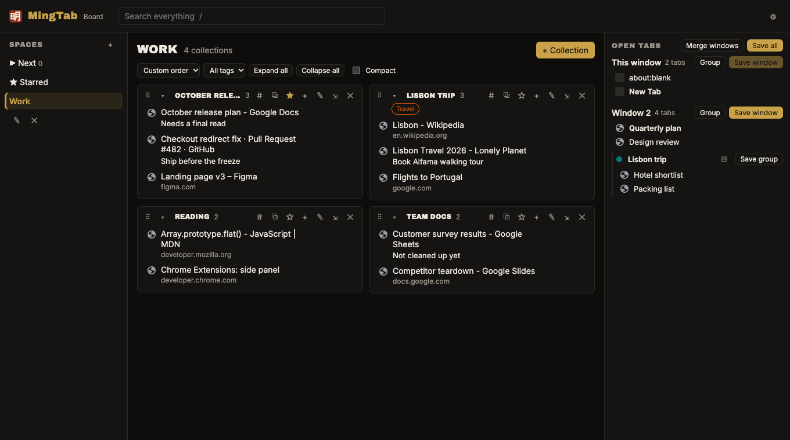
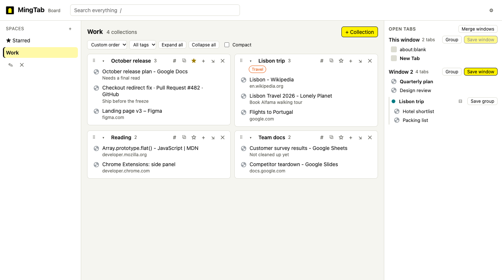
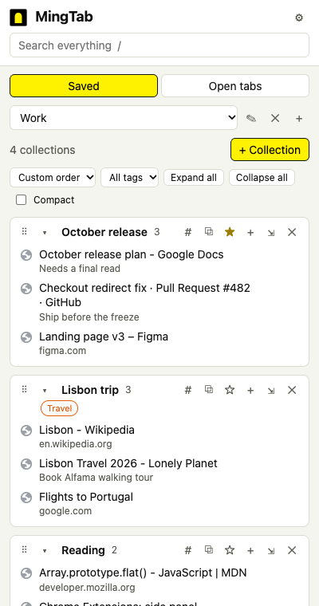
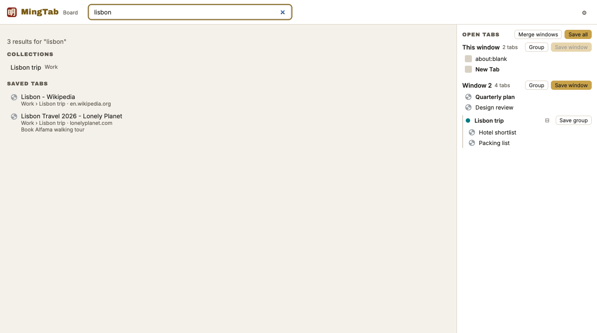

# MingTab

**A tab manager for Chrome that keeps your tab bar clear.** Save whole windows as collections,
organize them into spaces, and bring them back when you need them. MingTab is a personal
replacement for [Toby](https://www.gettoby.com/) that keeps everything on your own machine.




**Why "MingTab"?** 明堂 *míngtáng*, "the bright hall", is the open, uncluttered space in front of
a building in feng shui: the place where qi, the energy of a place, gathers before it flows
inside. Clutter there blocks it; a clear approach lets it in. 明 *míng*, "bright", joins 日 (sun)
and 月 (moon). Forty open tabs are a cluttered approach; MingTab keeps yours clear. The same note
is in the extension under **Settings → About MingTab**.

## What it does

- **Save tabs without losing them.** Save a window, a tab group or a single tab as a collection.
  Saving closes the tabs by default (you can keep them open instead).
- **Organize.** Spaces hold collections, and collections hold cards. Drag to reorder, move cards
  between collections, or drop a collection onto another space. Tag, star, sort and merge
  collections.
- **Bring them back.** Open one card, or a whole collection at once. A collection saved from a
  tab group reopens as a tab group with the same name and color.
- **Find anything.** One search across everything you've saved, your open tabs and (if you turn
  it on) your browsing history.
- **Tidy up.** Find pages saved more than once and remove the extra copies.
- **Manage open tabs.** See every window and tab group, rename and recolor groups, and merge all
  windows into one.
- **Import from Toby**, including which space each collection was in.
- **Next, notes and shortcuts.** A to-read queue, notes with checklists, and `to docs`-style
  shortcuts in the address bar (`to/ docs`).
- **Sync** across Chrome profiles and computers, through a small sync service on your own
  Cloudflare account, signed in with Google.
- **Light and dark themes**, in a black-and-yellow KR scheme or a terracotta one.

| Board in light mode | Side panel | Search |
|---|---|---|
|  |  |  |

---

## Install

MingTab isn't in the Chrome Web Store. You build it from this repository and load it into
Chrome yourself. It takes about five minutes the first time.

### What you need

| | Version | Get it |
|---|---|---|
| Google Chrome | Current | [google.com/chrome](https://www.google.com/chrome/) |
| Node.js (includes npm) | **22.12 or newer** (the LTS release is fine) | [nodejs.org](https://nodejs.org/) |
| Git | Any recent | macOS: `xcode-select --install` · Windows: [git-scm.com](https://git-scm.com/download/win) |
| Access to this repository | | It's private: you need to be signed in to GitHub as `kratner`, or have been given access |

Check what you have with `node --version` and `git --version`.

### 1. Pick a permanent folder and get the code

Chrome identifies an unpacked extension by the folder it was loaded from, and MingTab's data
belongs to that identity. **Choose a folder you'll keep**, and update in place rather than
moving it (see [Your data](#your-data)).

macOS (Terminal):

```sh
mkdir -p ~/Projects && cd ~/Projects
git clone git@github.com:kratner/mingtab.git
cd mingtab
```

Windows (PowerShell):

```powershell
mkdir $HOME\Projects -Force; cd $HOME\Projects
git clone https://github.com/kratner/mingtab.git
cd mingtab
```

Use the `git@github.com:` address if this machine has an SSH key for your GitHub account, or
the `https://` address to sign in through the browser instead. Either works on either system.

### 2. Build

```sh
npm ci
npm run build
```

`npm ci` installs exactly the versions in `package-lock.json`. `npm run build` writes the
extension to the `dist` folder.

### 3. Load it into Chrome

1. Open `chrome://extensions`.
2. Turn on **Developer mode** (top right).
3. Click **Load unpacked** and choose the **`dist`** folder inside `mingtab`
   (for example `~/Projects/mingtab/dist`, or `C:\Users\<you>\Projects\mingtab\dist`).
4. Click the puzzle-piece icon in the toolbar and **pin MingTab**.

Now:

- **Click the MingTab icon** to open the side panel.
- **Open a new tab** to see the full board.

> **If Toby (or another extension) also replaces the new-tab page**, Chrome can only use one.
> It usually goes with the most recently installed or enabled one, and may ask "Is this the new tab page you expected?".
> Keep MingTab, or turn the other extension off in `chrome://extensions`.

Each Chrome profile is separate. To use MingTab in your work and personal profiles, load it in
each one; for now each keeps its own data (see [Sync](#sync-across-machines-and-phone)).

### 4. Bring over your Toby data (optional)

1. In Toby, open **Settings → Export** and choose **.JSON**. Save the file.
2. *(Optional, keeps your spaces.)* Toby's export is a flat list of collections with no spaces.
   To keep them, sign in at [web.gettoby.com](https://web.gettoby.com), open the browser's
   DevTools console (⌥⌘J on Mac, Ctrl+Shift+J on Windows), paste the contents of
   [`scripts/toby-space-map.js`](scripts/toby-space-map.js) and press Enter. It downloads
   `toby-space-map.json`. The script only reads; it sends nothing anywhere and changes nothing
   in Toby.
3. In MingTab, open **Settings (⚙) → Import from Toby**, choose the export and, if you made one,
   the space map. Check the preview's counts, then click **Import**.

Empty collections are skipped by default; untick **Skip empty collections** to keep them.
Toby's note cards come across as titles only, because Toby doesn't export the note text.

### Updating

From the `mingtab` folder:

```sh
git pull
npm ci
npm run build
```

Then click the reload icon (↻) on MingTab's card in `chrome://extensions`. Your data stays.

### Uninstalling

**Download a backup first** (Settings → Backup): removing the extension deletes its data.
Then click **Remove** on MingTab in `chrome://extensions`.

---

## Using MingTab

| To | Do this |
|---|---|
| Save a whole window | Open tabs pane → **Save window** |
| Save a tab group | Open tabs pane → **Save group** on the group |
| Save one tab | Hover it in the open tabs pane → **⤓** → pick a collection, or drag it onto one (board only) |
| Reopen a collection | **⧉** in its header (a saved tab group comes back as a group) |
| Search | Type in the search box, or press **/** from anywhere. **Esc** clears. |
| Reorder | Drag a collection by **⠿**, or drag a card. Keyboard: focus it, **Space**, arrow keys, **Space**. |
| Move a collection to another space | Drag its **⠿** onto the space in the sidebar |
| Tag a collection | **#** in its header |
| Merge two collections | **⇲** in the header of the one to merge away |
| See starred collections | **★ Starred** at the top of the spaces list |
| Line up what to read next | **▶** on a card or an open tab; then **▶ Next** at the top of the spaces list. Tick items off, drag to reorder. |
| Write a note | **✎** in a collection's header. `- [ ] task` makes a checklist; `**bold**`, `*italic*` and links work. |
| Jump to a page from the address bar | Give a card a shortcut (✎ → Shortcut), then type **to/**, press Space, and type the shortcut: `to/ docs`. All shortcuts are listed in Settings. Toby uses the same keyword, so turn Toby off. |
| Use a popup instead of the side panel | Settings → **Toolbar button** |
| Sync another profile or computer | Settings → **Sign in with Google** |
| Remove duplicates | Settings → **Find duplicates** (nothing is removed until you confirm) |
| Keep tabs open when saving | Settings → untick **Close tabs after saving** |

Pinned tabs are never saved with a window or closed.

---

## Your data

Everything is stored **locally, inside the extension, in the Chrome profile you loaded it into**
(IndexedDB, plus a few display preferences in local storage). MingTab has no server and your
collections never leave the machine. The only network requests are site icons: Chrome's own
icon cache comes first, and if it doesn't have one, the icon saved with the card loads from that
site.

| Your data survives | Your data does **not** survive |
|---|---|
| Restarting Chrome or the computer | Removing the extension |
| Reloading the extension, `git pull`, rebuilding | Loading `dist` from a different folder (that's a new extension to Chrome) |
| Turning the extension off and on | Clearing data for the extension |

**Back up**: Settings → **Download backup** saves everything as one JSON file. **Restore from
backup** replaces what's in MingTab with the file's contents.

### Sync across machines

Settings → **Sign in with Google** in each Chrome profile, on each computer. Everything syncs
through the MingTab sync service (`worker/`, a Cloudflare Worker with a D1 database on Keith's
Cloudflare account), which accepts only the allowed Google account. Syncing runs every minute,
at startup, and a couple of seconds after any change. Signing out keeps your data on that device.

The phone version (a web app, since Chrome on phones doesn't run extensions) is next; see
[SYNC.md](SYNC.md).

### Permissions

| Permission | Why |
|---|---|
| `tabs`, `tabGroups` | List open tabs and groups, save them, reopen them, group/ungroup |
| `sidePanel` | Open MingTab in Chrome's side panel |
| `storage`, `unlimitedStorage` | Keep your collections locally, without Chrome's size cap |
| `favicon` | Show site icons from Chrome's own cache (no third-party icon service) |
| `history` (optional) | Only if you turn on history search; Chrome asks first |
| `identity` | Google sign-in for sync |
| `alarms` | Sync every minute |
| Access to `mingtab-sync.mingtab-sync.workers.dev` | The sync service, and no other site |
| Address-bar keyword `to/` | `to/ docs` opens your shortcut (Toby's keyword too: only one can have it) |
| New-tab page override | Show the board on new tabs |

MingTab never reads the content of the pages you visit, only the title, address and icon of tabs
you choose to save.

---

## Development

```sh
npm run dev        # live-reloading build in dist/ (needs the dev server running)
npm run build      # production build in dist/
npm run check      # typecheck + unit tests + browser tests
```

`npm run dev` makes a build that loads code from a local dev server. Run `npm run build` again
before using MingTab day to day, or it stops working when the dev server isn't running.

| Command | What it runs |
|---|---|
| `npm run typecheck` | TypeScript, no output |
| `npm test` | Unit tests (Vitest): data layer, import, search, duplicates, drag-and-drop logic |
| `npm run e2e` | Builds `dist-test/` (never `dist/`, which your Chrome loads) against a local copy of the sync service, then Playwright drives it in Chromium: saving windows and tab groups, drag and drop, import, search, notes, Next, shortcuts, layout at phone-to-desktop widths, and two profiles syncing |
| `npm run check` | All of the above, plus the sync service's tests |

The first browser-test run needs `npx playwright install chromium`. Tests that use a real Toby
export run only when one is present in `imports/`, a folder git ignores.

**Stack:** TypeScript, React, Vite with [CRXJS](https://crxjs.dev/) (Manifest V3), Dexie
(IndexedDB), dnd-kit (drag and drop), Vitest, Playwright.

```
src/
  app/        UI: board, side panel, collections, cards, settings
  db/         records, database, ordering (fractional positions), create/edit/delete
  dnd/        drag-and-drop rules (what can drop where) and the drag context
  import/     Toby import, MingTab backup/restore
  search/     search index and results
  dedupe/     duplicate detection
  tabs/       Chrome tabs, windows and tab groups; the open-tabs pane
  background.ts, sidepanel/, newtab/
e2e/          Playwright tests and fixtures
scripts/      toby-space-map.js, README screenshots, original icon script
branding/     icon concepts, render script, UI screenshots
```

Every record carries a UUID, `updatedAt`, a `deletedAt` tombstone and a fractional position, so
sync can be added without migrating data.

**Screenshots** in this README come from demo data, never personal collections:
`npm run build && node scripts/readme-screenshots.mjs`.

**Branding**: KR palette (`#FFF200` on black, from the KR mark). Icon concepts are in
`branding/icons/`; `node branding/render.mjs` renders a comparison sheet, and
`node branding/render.mjs --ship <name>` installs one as the extension icon (currently `d-ming`, 明; the 明-in-doorway logo `e-ming-doorway` is used for About and this README).

## Roadmap

[PLAN.md](PLAN.md) has the full feature comparison with Toby and the milestones:

- ✅ M0 scaffold · M1 spaces, collections, Toby import · M2 saving windows and tab groups ·
  M3 drag and drop · M4 search, tags, duplicates · M5 Next, notes, `to/` shortcuts, popup
- ✅ S1 sync across Chrome profiles and computers ([SYNC.md](SYNC.md))
- ⏳ S2 phone web app
